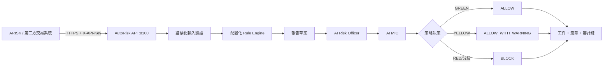
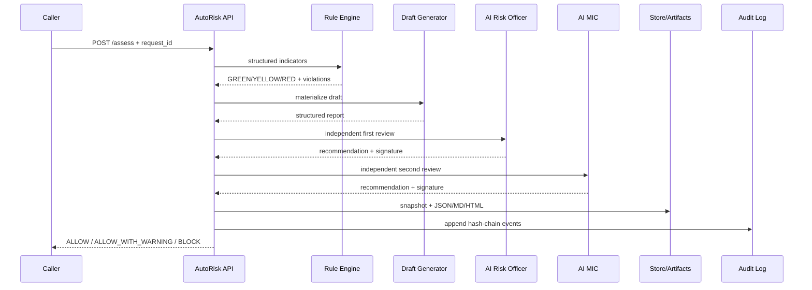

# AutoRisk 技術架構

## 1. 獨立部署邊界

AutoRisk 位於項目頂層 `autorisk/`，不導入 ARISK 其他層的 Python 模塊。集成方只能通過 HTTP API 或 `client.py` SDK 調用。



## 2. 目錄職責

```text
autorisk/
├── app/
│   ├── api/routes.py       # 對外 API
│   ├── core/rules.py       # 配置化規則引擎
│   ├── core/reporting.py   # 模板報告與評語草案
│   ├── core/ai_review.py   # 兩級 AI 覆核、LLM 可選適配
│   ├── core/workflow.py    # FULL_AI / HYBRID 狀態機
│   ├── core/crypto.py      # SHA-256 / HMAC 簽章
│   ├── core/artifacts.py   # JSON / Markdown / HTML 工件
│   ├── schemas.py          # 領域模型
│   ├── service.py          # 業務編排
│   ├── store.py            # 報告快照 repository
│   ├── audit.py            # append-only 哈希鏈審計
│   ├── security.py         # API Key 認證
│   └── main.py             # FastAPI 入口
├── config/rules.json       # 合同/監管/內控規則
├── data/                   # 報告、工件與審計資料
├── docs/                   # 需求、架構、API 文檔
├── tests/                  # 規則、服務、API 測試
├── client.py               # 第三方 Python SDK
├── run.py                  # 本地啟動
├── Dockerfile
└── docker-compose.yml
```

## 3. 四層業務模型

### 3.1 Trigger Layer

接收 PRE_TRADE、POST_TRADE、EOD、PERIODIC 和 EVENT。`request_id` 作為冪等鍵。

### 3.2 Data & Rule Engine

規則來自 `config/rules.json`。規則引擎是權威決策來源，AI 不可推翻紅線。

### 3.3 Draft Report Generator

使用結構化模板生成一致的 JSON/Markdown/HTML。HTML 可由瀏覽器或企業 PDF 服務列印為 PDF。

### 3.4 Workflow & Audit

- FULL_AI：AI Risk Officer + AI MIC；
- HYBRID：AI 先提供建議，再由人工 Risk Officer + MIC 雙簽；
- 所有簽章使用 HMAC-SHA256；
- 所有狀態變更寫入 append-only SHA-256 哈希鏈。

## 4. 評估序列



## 5. AI 安全架構

1. 規則引擎先執行；
2. AI 僅覆核和解釋；
3. 紅燈固定 REJECT/BLOCK；
4. 兩級 AI 分歧則 BLOCK；
5. 外部 LLM 失效時回退確定性策略；
6. LLM temperature 固定為 0；
7. LLM 不接收簽章密鑰或 API Key。

## 6. 存儲與完整性

- `risk_reports.json`：報告最新快照；
- `audit_events.jsonl`：append-only 審計鏈；
- `data/reports/{report_id}`：JSON、Markdown、HTML 工件；
- `content_hash`：報告主內容哈希；
- `signature`：每級審批 HMAC 簽章；
- `/verify`：一次驗證報告、簽章、工件與審計鏈。

文件 repository 適用於獨立演示和單實例部署。多實例生產部署應實現相同接口的 PostgreSQL/S3 adapter。

## 7. 安全邊界

- 健康檢查公開；
- 其餘 API 要求 `X-API-Key`；
- 生產密鑰通過環境變量注入；
- 工件下載執行路徑白名單校驗；
- 回調默認關閉；
- CORS 生產環境應配置具體來源，不能使用 `*`。
