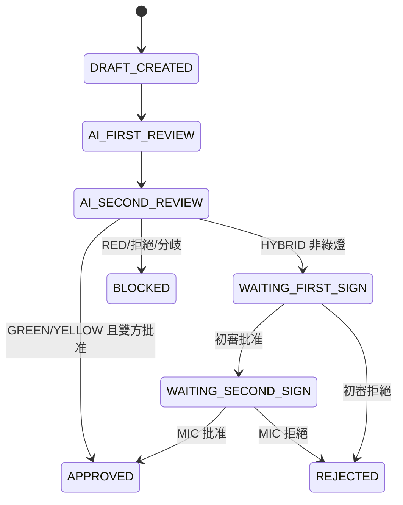

# AutoRisk 智能風控評估系統需求說明書

版本：1.0  
日期：2026-07-15

## 1. 建設背景

AutoRisk 面向基金管理場景建立標準化智能風控決策閉環，把專業風控要求轉化為：

1. 結構化風險資料輸入；
2. 確定性規則引擎校驗；
3. 標準模板生成風控評估草案；
4. 兩級獨立 AI 覆核與數字簽章；
5. 自動放行、帶警告放行或阻斷；
6. 報告與審計鏈歸檔。

核心風控環節如下：

| 風控環節 | AutoRisk 實現 |
|---|---|
| 風險數據接入 | 交易指令、持倉、NAV、風險指標及市場快照 |
| 風險規則判定 | 合同、監管要求及公司內控規則 |
| 評估報告生成 | 結構化風控評估草案與處置建議 |
| 第一級覆核 | AI Risk Officer / 人工風控專員初審 |
| 第二級覆核 | AI MIC / 人工 MIC 終審 |
| 執行與審計 | HMAC 簽章、報告哈希、append-only 審計鏈及放行阻斷決策 |

## 2. 系統定位與邊界

AutoRisk 是頂層獨立服務，不依賴主項目的 `2_processing`、`backend` 或 `frontend`。本項目及第三方均只通過 HTTP API 調用。

系統負責：

- 接收風控觸發事件；
- 執行規則與風險分級；
- 生成 JSON、Markdown、HTML 報告；
- 執行 FULL_AI 或 HYBRID 雙簽工作流；
- 返回 ALLOW、ALLOW_WITH_WARNING 或 BLOCK；
- 保存簽章、工件和審計事件。

系統不負責：

- 實際交易撮合或下單；
- 基金主數據治理；
- 代替法律要求的持牌自然人簽署；
- 在缺少結構化資料時由 AI 憑空生成決策。

> FULL_AI 適用於內部自動控制、沙盒和已獲制度授權的場景。如司法管轄區或公司制度要求具名人員簽署，必須配置 `HYBRID`。

## 3. 業務目標

- 交易前先評估、後執行；
- 綠燈快速自動放行；
- 黃燈帶警告自動放行或轉人工；
- 紅燈 fail-closed，自動阻斷；
- AI 僅解釋確定性規則結論，不得推翻紅線；
- 每份報告可驗證、可重放、可審計；
- 支持同一請求冪等重試；
- 支持本項目及第三方 API 接入。

## 4. 參與角色

| 角色 | 職責 |
|---|---|
| 調用系統 | 提交交易、持倉、指標及市場快照 |
| Rule Engine | 執行合同、監管及內控規則 |
| AI Risk Officer | 第一級獨立風控覆核 |
| AI MIC | 第二級獨立終審覆核 |
| 人工 Risk Officer | HYBRID 模式初審及修改意見 |
| 人工 MIC | HYBRID 模式最終放行或拒絕 |
| 審計員 | 查詢審計鏈及驗證報告完整性 |

## 5. 觸發場景

- `PRE_TRADE`：擬投資指令、IPO、大額申報、限額預估；
- `POST_TRADE`：成交後偏離、持倉集中度變化；
- `EOD`：日終持倉、流動性、槓桿與 VaR；
- `PERIODIC`：週/月/季度例行評估；
- `EVENT`：市場劇烈波動、監管新規、信用事件。

## 6. 結構化輸入需求

每個請求至少包含：

- `request_id`：調用方冪等鍵；
- `trigger_source`；
- `fund_code`、`fund_name`；
- `indicators`：槓桿率、集中度、VaR、流動性等；
- `proposed_trade`：擬交易內容；
- `market_snapshot`：評估時點市場證據；
- `metadata`：來源系統、操作者、批次等。

不允許 AI 在缺失關鍵指標時自行補造資料。

## 7. 規則引擎需求

規則保存在 `config/rules.json`，無需改代碼即可更新。每條規則包含：

- 規則編號與名稱；
- 指標名稱；
- 高值風險或低值風險方向；
- 黃燈、紅燈閾值；
- 黃燈、紅燈處置；
- 監管/合同引用；
- 是否啟用。

初始規則：

- 槓桿率；
- 單一標的集中度；
- 1 日 95% VaR；
- 最低流動性比例。

規則引擎必須先於 AI 執行，其結果是不可被 LLM 推翻的硬約束。

## 8. 風險分級與執行決策

| 等級 | 說明 | FULL_AI 決策 | HYBRID 決策 |
|---|---|---|---|
| GREEN | 未命中紅黃燈 | AI 雙簽後 `ALLOW` | 可自動或按制度處理 |
| YELLOW | 接近閾值 | AI 雙簽後 `ALLOW_WITH_WARNING` | 等待人工雙簽 |
| RED | 命中合同/內控紅線 | AI 雙簽確認後 `BLOCK` | 等待人工雙簽；覆蓋需明確原因 |
| AI 分歧/異常 | 兩級結論不同 | fail-closed，`BLOCK` | 轉人工處理 |

## 9. AI 雙重覆核需求

### 9.1 第一級：AI Risk Officer

- 檢查結構化輸入與規則命中；
- 給出 APPROVE/REJECT；
- 生成原因、關切點、信心度；
- 寫入第一份數字簽章。

### 9.2 第二級：AI MIC

- 獨立重新覆核；
- 不直接沿用第一級文字；
- 給出最終建議及第二份數字簽章；
- 與第一級結論不一致時自動阻斷。

### 9.3 LLM 邊界

- 默認 `deterministic` provider 可離線運行；
- 可配置 OpenAI-compatible 模型生成覆核說明；
- LLM 只能生成解釋，不能改變規則引擎決策；
- LLM 不可用時自動降級至確定性策略。

## 10. 報告需求

每次評估產生：

- 結構化 JSON；
- Markdown 工作底稿；
- 可列印成 PDF 的 HTML；
- 報告內容 SHA-256；
- 每個工件 SHA-256；
- 初審與終審 HMAC 簽章；
- 最終執行決策。

報告字段至少包括報告/請求編號、規則版本、指標、命中規則、AI 覆核、簽章、狀態、工件和內容哈希。

## 11. 狀態機

終態不可隨意覆寫；紅燈人工覆蓋必須提供明確原因且保留審計事件。

## 12. 安全與審計需求

- 所有業務 API 使用 `X-API-Key`；
- API Key 使用常量時間比較；
- 每次狀態變更追加一條審計事件；
- 審計事件使用 `previous_hash + event_hash` 形成哈希鏈；
- 報告和工件支持完整性驗證；
- 文件下載必須阻止路徑穿越；
- 生產環境必須替換默認 API Key 與簽章密鑰；
- 回調默認關閉，啟用時使用 `X-AutoRisk-Signature` 驗證。

## 13. API 需求

- 建立評估：`POST /api/v1/risk-evals/assess`
- 報告列表：`GET /api/v1/risk-evals/reports`
- 報告詳情：`GET /api/v1/risk-evals/reports/{report_id}`
- 完整性驗證：`GET /api/v1/risk-evals/reports/{report_id}/verify`
- 人工初審：`POST /api/v1/risk-evals/reports/{report_id}/sign/first`
- 人工終審：`POST /api/v1/risk-evals/reports/{report_id}/sign/second`
- 拒絕：`POST /api/v1/risk-evals/reports/{report_id}/reject`
- 工件下載：`GET /api/v1/risk-evals/reports/{report_id}/artifacts/{filename}`
- 規則查詢/重載：`GET /rules`、`POST /rules/reload`
- 審計查詢/驗證：`GET /audit`、`GET /audit/verify`
- 健康檢查：`GET /health`

## 14. 非功能需求

- Python 3.11+；
- 可從 `autorisk/` 目錄獨立啟動；
- API-only，無主前端依賴；
- 支持 Docker；
- 評估接口支持 `request_id` 冪等；
- AI/LLM 故障時 fail-safe；
- 默認文件存儲可替換為 PostgreSQL repository；
- 報告數據與審計數據分離存儲。

## 15. 驗收標準

1. 綠燈請求在 FULL_AI 下得到兩個 AI 簽章和 `ALLOW`；
2. 黃燈請求得到 `ALLOW_WITH_WARNING`；
3. 紅燈請求必須得到 `BLOCK`，不可盲目放行；
4. 相同 `request_id` 重試返回同一報告；
5. HYBRID 第二簽不能跳過第一簽；
6. 雙簽身份必須不同；
7. JSON/Markdown/HTML 工件均可生成並下載；
8. 報告、簽章、工件及審計鏈驗證通過；
9. 無 API Key 的業務請求返回 401；
10. 模塊測試全部通過且可獨立啟動。
