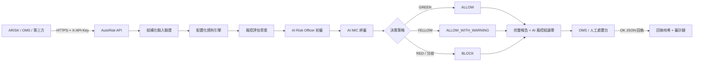
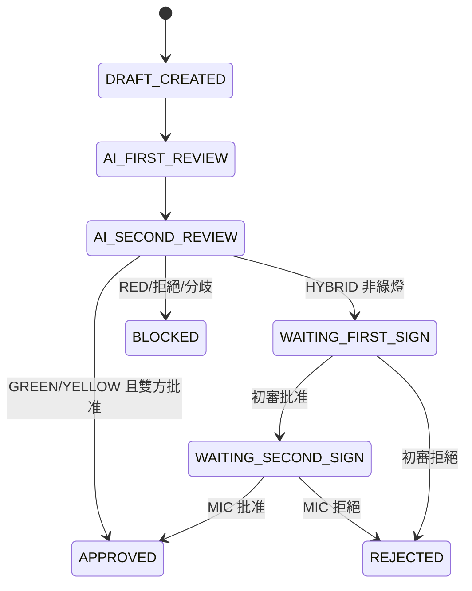

# AutoRisk 功能、模塊與使用手冊

## 1. 模塊定位

AutoRisk 是一個可獨立運行、僅暴露 HTTP API 的基金風控評估服務，默認監聽 `8100` 端口。它不依賴主項目的 `2_processing`、`backend` 或 `frontend`，本項目與第三方系統均通過 API 或 Python SDK 調用。

AutoRisk 建立從風險數據接入、規則判定、智能覆核到執行控制與審計歸檔的標準化閉環：

| 風控環節 | AutoRisk 實現 |
|---|---|
| 風險數據接入 | 交易指令、持倉、NAV、風險指標及市場快照 |
| 風險規則判定 | 基金合同、監管要求及公司內控規則 |
| 評估報告生成 | 自動生成結構化風控評估草案與處置建議 |
| 第一級智能覆核 | AI Risk Officer / 人工風控專員初審 |
| 第二級智能覆核 | AI MIC / 人工 MIC 終審 |
| 執行與審計控制 | HMAC 雙簽、報告哈希、審計哈希鏈及放行阻斷決策 |

AutoRisk 不是讓 LLM 憑空生成風控決策，而是採用：

```text
結構化輸入
  -> 配置化規則引擎
  -> 標準化報告草案
  -> 兩級獨立 AI 覆核
  -> 數字雙簽
  -> 自動放行、警告放行或阻斷
  -> 報告與審計歸檔
```

## 2. 核心功能

- 獨立 FastAPI 服務，默認端口 `8100`
- PRE_TRADE、POST_TRADE、EOD、PERIODIC、EVENT 五類觸發
- 結構化交易、持倉、風險指標及市場快照輸入
- JSON 配置化規則引擎
- 任意數值型擴展指標與規則熱重載，新增規則指標無需修改 Python schema
- GREEN、YELLOW、RED 三級風險評估
- 標準化風控評估報告
- AI Risk Officer 第一級獨立覆核
- AI MIC 第二級獨立終審
- HMAC-SHA256 數字雙簽
- FULL_AI 與 HYBRID 兩種工作流
- `request_id` 冪等控制，避免重複生成報告
- JSON、Markdown、HTML 完整報告及 JSON、HTML 結論單共五種工件
- 類似電子處方的明確風控結論：准予執行、附條件准予執行或禁止執行
- 綁定報告哈希及最終決策的幂等下游 `OK` 回執
- 報告、簽章、工件完整性驗證
- append-only SHA-256 審計哈希鏈
- `X-API-Key` 接口認證
- 可選 HMAC 簽名 webhook 回調
- Docker 獨立部署
- 第三方 Python SDK
- 可選 OpenAI-compatible LLM 評語生成
- LLM 不可用時自動降級為確定性策略

## 3. FULL_AI 決策策略

FULL_AI 是默認模式。兩個 AI 角色按順序獨立覆核，但規則引擎始終是權威決策來源。

| 風險級別 | AI 雙簽結果 | 執行決策 |
|---|---|---|
| GREEN | 兩級 AI 批准 | `ALLOW` |
| YELLOW | 兩級 AI 批准並保留警告 | `ALLOW_WITH_WARNING` |
| RED | 兩級 AI 確認紅線 | `BLOCK` |
| AI 結論不一致 | fail-closed | `BLOCK` |

LLM 只負責生成專業解釋，不能推翻規則引擎的紅線結論。RED 報告不會因 AI 自由推理而被盲目放行。

如法律、監管或公司制度要求具名自然人簽署，應使用 `HYBRID` 模式。

## 4. 架構流程



## 5. 目錄與模塊

```text
autorisk/
├── app/
│   ├── api/routes.py       # 對外 REST API
│   ├── core/rules.py       # 配置化規則引擎
│   ├── core/reporting.py   # 報告模板與自動評語
│   ├── core/ai_review.py   # 兩級 AI 覆核及可選 LLM 適配
│   ├── core/workflow.py    # FULL_AI / HYBRID 狀態機
│   ├── core/scenario.py    # 加倉場景數據適配與風險計算
│   ├── core/conclusion.py  # AI 風控結論單與處置指令
│   ├── core/crypto.py      # SHA-256 及 HMAC 簽章
│   ├── core/artifacts.py   # JSON / Markdown / HTML 工件
│   ├── static/             # FastAPI 內置可視化演示頁
│   ├── schemas.py          # Pydantic 領域模型
│   ├── service.py          # 完整業務流程編排
│   ├── store.py            # 報告快照與獨立回執存儲
│   ├── audit.py            # append-only 審計哈希鏈
│   ├── security.py         # API Key 認證
│   ├── config.py           # 環境變量配置
│   └── main.py             # FastAPI 應用入口
├── config/rules.json       # 合同、監管及內控規則
├── data/                   # 報告、工件與審計數據
├── docs/                   # 需求、架構、API 文檔
├── tests/                  # 規則、服務和 API 測試
├── scripts/                # PowerShell 演示腳本
├── client.py               # 第三方 Python SDK
├── run.py                  # 本地啟動入口
├── Dockerfile
├── docker-compose.yml
├── .env.example
└── requirements.txt
```

### 5.1 API 層

`app/api/routes.py` 對外暴露評估、查詢、人工雙簽、拒絕、工件下載、規則管理及審計驗證 API。

### 5.2 規則引擎

`app/core/rules.py` 從 `config/rules.json` 加載規則。規則配置包括：

- 規則編號與名稱
- 指標字段
- 高值風險或低值風險方向
- 黃燈及紅燈閾值
- 命中後的處置動作
- 監管、合同或內控引用
- 啟用狀態

初始規則包括槓桿率、單一標的集中度、1 日 95% VaR 和最低流動性比例。

### 5.3 AI 覆核

`app/core/ai_review.py` 實現兩級獨立覆核：

1. AI Risk Officer 初審；
2. AI MIC 終審。

默認使用離線確定性策略。配置 OpenAI-compatible Provider 後，LLM 只生成覆核理由，最終決策仍受規則引擎約束。

### 5.4 工作流

`app/core/workflow.py` 負責：

- AI 初審與終審順序
- AI 兩級結論一致性校驗
- GREEN、YELLOW、RED 處置
- fail-closed 阻斷
- FULL_AI 與 HYBRID 模式分流

### 5.5 數字簽章與完整性

`app/core/crypto.py` 實現：

- 報告內容 SHA-256
- 初審 HMAC-SHA256 簽章
- 終審 HMAC-SHA256 簽章
- 簽章驗證

每份簽章綁定報告 ID、報告哈希、簽署身份、角色、決策、時間及審批意見。

### 5.6 審計鏈

`app/audit.py` 使用 JSONL append-only 存儲。每條事件包含：

- 順序號
- 事件 ID
- 報告 ID
- 操作者
- 事件類型
- 事件內容
- 前一事件哈希
- 當前事件哈希

修改任何歷史事件都會導致審計鏈驗證失敗。

### 5.7 報告工件

每次評估會在 `data/reports/{report_id}/` 生成：

- `{report_id}.json`
- `{report_id}.md`
- `{report_id}.html`
- `{report_id}.conclusion.json`
- `{report_id}.conclusion.html`

完整報告保留全部指標、規則命中和覆核詳情；結論單以類似電子處方的格式突出最終處置指令、有效期、限制、雙簽及驗證哈希。HTML 可直接在瀏覽器打開，或使用瀏覽器列印功能輸出 PDF。

## 6. 工作流狀態



主要狀態包括：

- `DRAFT_CREATED`
- `AI_FIRST_REVIEW`
- `AI_SECOND_REVIEW`
- `WAITING_FIRST_SIGN`
- `WAITING_SECOND_SIGN`
- `WAITING_REVIEW_APPROVAL`
- `APPROVED`
- `REJECTED`
- `BLOCKED`
- `ARCHIVED`
- `EXPIRED`

## 7. 本地啟動

在項目根目錄執行：

```powershell
Set-Location autorisk
python -m pip install -r requirements.txt
Copy-Item .env.example .env
python run.py
```

啟動後訪問：

- Health：`http://127.0.0.1:8100/health`
- Swagger：`http://127.0.0.1:8100/docs`
- OpenAPI：`http://127.0.0.1:8100/openapi.json`

默認開發 API Key：`autorisk-dev-key`。

生產環境必須修改 `.env` 中的 `AUTORISK_API_KEYS` 和 `AUTORISK_SIGNING_SECRET`。

## 8. Docker 啟動

```powershell
Set-Location autorisk
Copy-Item .env.example .env
docker compose up --build
```

報告與審計數據會持久化到本機 `autorisk/data/`。

## 9. 建立風控評估

### 9.1 可視化風控審核

服務啟動後訪問 `http://127.0.0.1:8100/demo`，可在網頁輸入：

- 觸發來源
- 基金代碼與基金名稱
- 核心風險指標（槓桿率、集中度、VaR、流動性）
- 可選的擬議交易與附加元數據（JSON）

FastAPI 後端會完成以下流程：

1. 驗證業務請求並標準化風險指標；
2. 執行合同、監管及公司內控規則；
3. 生成結構化風控評估報告；
4. 執行 AI Risk Officer 與 AI MIC 兩級獨立覆核；
5. 返回 `ALLOW`、`ALLOW_WITH_WARNING` 或 `BLOCK`；
6. 生成雙簽、完整報告、AI 風控結論單及審計證據；
7. 接收下游綁定報告哈希與最終決策的 `OK` JSON 回執。

網頁調用 `POST /api/v1/risk-evals/assess`，響應為正式 AutoRisk 評估報告，適合持續接收不同業務請求並反覆執行 AI 風控審核。

`POST /api/v1/risk-evals/demo/assess` 仍可作為離線加倉場景示例接口使用；生產環境應優先使用通用 `assess` 接口，並由上游系統提供真實 NAV、持倉、行情與風險數據。

### 9.2 PowerShell 示例

```powershell
$body = @{
  request_id = "OMS-20260715-0001"
  trigger_source = "PRE_TRADE"
  fund_code = "990001.HK"
  fund_name = "平衡增長一號基金"
  indicators = @{
    leverage_ratio = 1.10
    single_stock_concentration = 0.09
    var_95_1d = 0.018
    liquidity_ratio = 0.25
  }
  proposed_trade = @{
    symbol = "700.HK"
    side = "BUY"
    notional_hkd = 10000000
  }
  market_snapshot = @{
    snapshot_time = "2026-07-15T09:42:18Z"
  }
} | ConvertTo-Json -Depth 8

Invoke-RestMethod -Method Post `
  -Uri "http://127.0.0.1:8100/api/v1/risk-evals/assess" `
  -Headers @{ "X-API-Key" = "autorisk-dev-key" } `
  -ContentType "application/json" `
  -Body $body
```

相同 `request_id` 重試時會返回原報告，不會重複生成。

### 9.3 主要輸出

```json
{
  "report_id": "RC-20260715-XXXXXXXX",
  "request_id": "OMS-20260715-0001",
  "severity": "YELLOW",
  "status": "APPROVED",
  "execution_decision": "ALLOW_WITH_WARNING",
  "ai_recommendation": "APPROVE",
  "ai_reviews": [],
  "first_sign": {},
  "second_sign": {},
  "content_hash": "...",
  "artifacts": []
}
```

### 9.4 AI 風控結論單與 OK 回執

最終報告可通過 `GET /reports/{report_id}/conclusion` 取得明確處置結論：

- `APPROVED / PROCEED`：准予執行；
- `APPROVED_WITH_CONDITIONS / PROCEED_WITH_CONTROLS`：附條件准予執行；
- `NOT_APPROVED / DO_NOT_PROCEED`：禁止執行。

下游完成放行、控制措施或阻斷後，調用 `POST /reports/{report_id}/feedback` 回傳 `OK`。回執必須提供本次看到的 `observed_report_hash` 和 `observed_decision`；任一不一致均返回 `409`，避免對錯報告或錯結論確認。相同冪等鍵與相同內容可安全重試。

## 10. API 接口

所有業務接口都需要 Header：

```text
X-API-Key: autorisk-dev-key
```

| 方法 | 接口 | 功能 |
|---|---|---|
| POST | `/api/v1/risk-evals/assess` | 建立並執行風控評估 |
| POST | `/api/v1/risk-evals/demo/assess` | 離線示例：計算加倉場景並執行完整風控評估 |
| GET | `/api/v1/risk-evals/reports` | 查詢報告列表 |
| GET | `/api/v1/risk-evals/reports/{report_id}` | 查詢報告詳情 |
| GET | `/api/v1/risk-evals/reports/{report_id}/conclusion` | 查詢 AI 風控結論單 |
| GET | `/api/v1/risk-evals/reports/{report_id}/conclusion/download` | 下載結論單 JSON 或 HTML |
| POST | `/api/v1/risk-evals/reports/{report_id}/feedback` | 提交下游處置回執 |
| GET | `/api/v1/risk-evals/reports/{report_id}/feedback` | 查詢回執列表 |
| GET | `/api/v1/risk-evals/reports/{report_id}/feedback/{idempotency_key}/download` | 下載回執 JSON |
| GET | `/api/v1/risk-evals/reports/{report_id}/verify` | 驗證報告完整性 |
| POST | `/api/v1/risk-evals/reports/{report_id}/sign/first` | HYBRID 人工初審 |
| POST | `/api/v1/risk-evals/reports/{report_id}/sign/second` | HYBRID 人工終審 |
| POST | `/api/v1/risk-evals/reports/{report_id}/reject` | 人工拒絕 |
| GET | `/api/v1/risk-evals/reports/{report_id}/artifacts/{filename}` | 下載報告工件 |
| GET | `/api/v1/risk-evals/rules` | 查看規則 |
| POST | `/api/v1/risk-evals/rules/reload` | 重載規則 |
| GET | `/api/v1/risk-evals/audit` | 查看審計事件 |
| GET | `/api/v1/risk-evals/audit/verify` | 驗證審計鏈 |
| GET | `/health` | 健康檢查 |

## 11. 查詢與驗證

```powershell
$headers = @{ "X-API-Key" = "autorisk-dev-key" }

Invoke-RestMethod `
  "http://127.0.0.1:8100/api/v1/risk-evals/reports" `
  -Headers $headers

Invoke-RestMethod `
  "http://127.0.0.1:8100/api/v1/risk-evals/reports/<report_id>/verify" `
  -Headers $headers

Invoke-RestMethod `
  "http://127.0.0.1:8100/api/v1/risk-evals/audit/verify" `
  -Headers $headers
```

報告驗證包括：

- 報告內容哈希
- AI 初審簽章
- AI 終審簽章
- JSON/Markdown/HTML 工件哈希
- 審計哈希鏈

## 12. Python SDK 使用

第三方或本項目可使用 `client.py`：

```python
from client import AutoRiskClient

with AutoRiskClient(api_key="autorisk-dev-key") as client:
    report = client.assess({
        "request_id": "OMS-20260715-0002",
        "trigger_source": "PRE_TRADE",
        "fund_code": "990001.HK",
        "indicators": {
            "leverage_ratio": 1.0,
            "single_stock_concentration": 0.05,
            "var_95_1d": 0.01,
            "liquidity_ratio": 0.30
        }
    })
    print(report["report_id"], report["execution_decision"])
```

## 13. HYBRID 人工雙簽

在 `.env` 設置：

```text
AUTORISK_WORKFLOW_MODE=HYBRID
```

非綠燈報告完成 AI 建議後會進入 `WAITING_FIRST_SIGN`。

人工初審要求角色為 `RISK_OFFICER` 或 `REVIEWER`；終審角色必須為 `MIC`；兩名簽署者身份不能相同。

RED 報告如果人工選擇覆蓋批准，終審意見必須填寫明確的 override 原因。

## 14. 規則配置

規則文件位於 `config/rules.json`。修改後可重啟服務，或調用：

```text
POST /api/v1/risk-evals/rules/reload
```

規則引擎支持：

- `HIGH_IS_RISK`：數值越高風險越高
- `LOW_IS_RISK`：數值越低風險越高
- 黃燈閾值
- 紅燈閾值
- 黃燈與紅燈處置
- 監管或合同引用

## 15. 可選 LLM 配置

默認配置：

```text
AUTORISK_AI_PROVIDER=deterministic
```

如需使用 OpenAI-compatible LLM 生成覆核理由：

```text
AUTORISK_AI_PROVIDER=openai-compatible
AUTORISK_LLM_BASE_URL=https://your-provider.example/v1
AUTORISK_LLM_API_KEY=your-key
AUTORISK_LLM_MODEL=your-model
```

無論使用哪一個模型，LLM 都不能改變 RED 自動阻斷策略。

## 16. Webhook 回調

回調默認關閉。啟用方式：

```text
AUTORISK_CALLBACK_ENABLED=true
```

評估請求中可提供 `callback_url`。回調包含：

```text
X-AutoRisk-Event: risk-evaluation.completed
X-AutoRisk-Signature: <HMAC-SHA256>
```

接收方應使用相同的 `AUTORISK_SIGNING_SECRET` 驗證原始 JSON body。

## 17. 測試與驗證

```powershell
Set-Location autorisk
python -m compileall -q .
python -m pytest tests -q
```

目前驗證結果：

- Python 完整編譯通過
- 自動測試 `13/13` 通過
- VS Code 診斷無錯誤
- 端到端 RED 場景成功返回 `BLOCKED` / `BLOCK`
- AI 覆核 2 級
- 報告及結論單工件 5 個
- AI 風控結論單哈希有效
- `OK` 回執幂等、錯哈希拒絕及獨立存儲驗證通過
- 兩份數字簽章有效
- 報告內容哈希有效
- 工件哈希全部有效
- 審計哈希鏈有效

## 18. 生產部署注意事項

1. 必須替換默認 API Key；
2. 必須替換默認簽章密鑰；
3. CORS 應限制為明確域名，不能使用 `*`；
4. 如要求持牌自然人簽署，必須使用 HYBRID；
5. 單實例可使用文件存儲，多實例應替換為 PostgreSQL/S3 adapter；
6. 啟用 webhook 前應限制允許的回調域名；
7. 規則更新應經版本審批，並保留歷史規則版本；
8. 不應將市場數據、持倉或密鑰寫入日誌；
9. RED 報告應始終 fail-closed；
10. 建議在 HTTPS、API Gateway、WAF 及集中式密鑰管理後部署。

## 19. 相關文檔

- [README](README.md)
- [完整需求說明書](docs/requirements_spec.md)
- [技術架構](docs/architecture.md)
- [API 使用指南](docs/api_guide.md)
