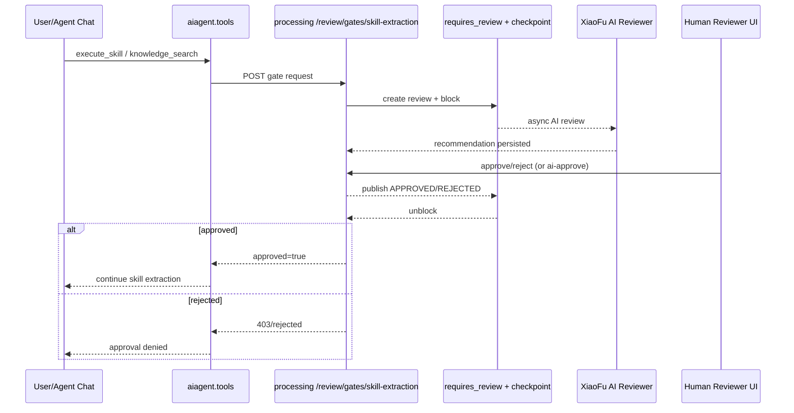

# Skill Approval Workflow (小富 AI + 人工審核)

本文檔說明「專家知識提取 + Agent Chat 技能提取」的審批流程如何構建、狀態如何流轉、以及模塊化實現位置。

## 1. 目標

把以下高風險提取流程接入強制審批：

- Agent Chat 技能提取：`execute_skill`
- 專家知識提取：`knowledge_search`（source 為 `skill_doc` / `agent_prompt` / `expert_chat`）

要求：

- 支持小富 AI 審核建議
- 支持人工審核決策
- 具備清晰狀態機、可審計、可恢復

## 2. 模塊分工

- Agent 調用入口
  - `aiagent/engine/tools.py`
  - 函數：`_request_skill_extraction_approval`
  - 職責：在提取前先調 Processing gate

- 審批 gate API
  - `2_processing/api/routers/review.py`
  - 端點：`POST /review/gates/skill-extraction`
  - 職責：統一承接提取審批請求

- 審批阻塞與放行
  - `2_processing/review/checkpoint.py`
  - 能力：`requires_review` + `ReviewCheckpoint`
  - 職責：創建審批單、checkpoint 阻塞、等待批准/拒絕

- 審核管理與審計
  - `2_processing/review/review_manager.py`
  - 職責：狀態流轉、決策寫入、audit log、解鎖 checkpoint

- 小富 AI 審核
  - `2_processing/review/ai_reviewer.py`
  - 職責：異步生成 AI 建議（APPROVE/REJECT/ESCALATE/REQUIRE_HUMAN）

- 人工審核界面
  - `6_entry/web/static/index.html`
  - 路由代理：`6_entry/web/routers/review_ui.py`
  - 職責：收件箱、詳情、認領、批准/拒絕、採納小富建議

## 3. 流程狀態機

主狀態（`review_requests.status`）：

- `PENDING`：待審核
- `IN_REVIEW`：已認領審核中
- `APPROVED`：批准放行
- `REJECTED`：拒絕中止
- `EXPIRED`：超時過期

checkpoint 行為：

- 進入 gate 時建立 `agent_checkpoints` 記錄並阻塞
- 批准/拒絕後由 Redis pub/sub 事件解鎖
- 被批准的提取流程繼續執行
- 被拒絕的提取流程返回 403 或審批失敗信息

## 4. 序列圖

## 5. 已實現的觸發規則

- `execute_skill`：每次調用都走審批 gate
- `knowledge_search`：僅當 `source` 為 `skill_doc` / `agent_prompt` / `expert_chat` 時走審批 gate

配置開關：

- 環境變量 `SKILL_EXTRACTION_REVIEW_REQUIRED`
  - `true`（默認）：啟用強制審批
  - `false`：跳過審批 gate（僅建議在本地調試）

## 6. API 與操作

1. 創建並阻塞審批 gate
- `POST /review/gates/skill-extraction`
- Header：`X-API-Key`
- Query：`fund_id`, `as_of_date`（可選）
- Body：`channel`, `skill_name`, `query`, `triggered_by`, `payload`

2. 人工審核入口
- `GET /review-ui/inbox`
- `POST /review-ui/inbox/{review_id}/claim`
- `POST /review-ui/inbox/{review_id}/approve`
- `POST /review-ui/inbox/{review_id}/reject`
- `POST /review-ui/inbox/{review_id}/ai-approve`

3. 審計追蹤
- `GET /review/history/audit-log`

## 7. 模塊化擴展建議

- 新增更多需審批行為時，復用 gate 模式：
  - 在 `review.py` 增加新 gate 端點
  - 使用 `requires_review` 聲明類別、標題、超時策略
  - 在上游工具調用點接入 gate

- 類別治理：
  - 可按行為拆分 category，例如 `SKILL_EXTRACTION`, `EXPERT_KNOWLEDGE_EXPORT`
  - 配置獨立 SLA/優先級

- 審批策略：
  - 小富 AI 僅作建議，不直接替代人工
  - 對高風險類別保留「必須人工審核」規則

## 8. 驗證清單

- 觸發提取時，收件箱應出現 PENDING
- 小富 AI 面板應出現 pending -> completed
- 批准後請求能放行，拒絕後請求被阻止
- 審計日誌可追溯（誰、何時、為何批准/拒絕）
